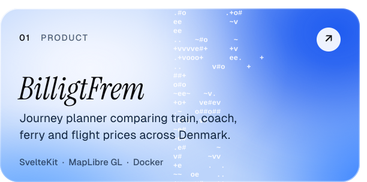
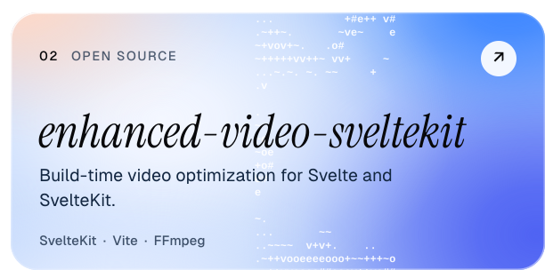
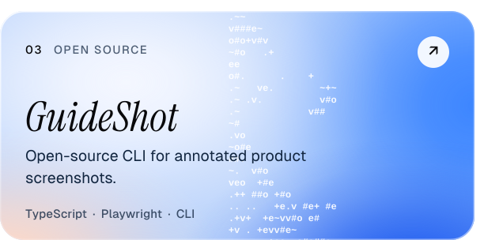
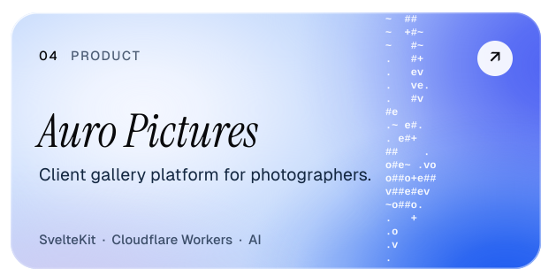

  
  
  

#### Recent activity

<!--RECENT_ACTIVITY:start-->
1. 🔱 Forked [victorDigital/agent-top](https://github.com/victorDigital/agent-top) from [kannandreams/agent-top](https://github.com/kannandreams/agent-top) 
<!--RECENT_ACTIVITY:end-->

<!--RECENT_ACTIVITY:last_update-->
Last Updated: Monday, November 16th, 2026, 8:16:09 AM
<!--RECENT_ACTIVITY:last_update_end-->
